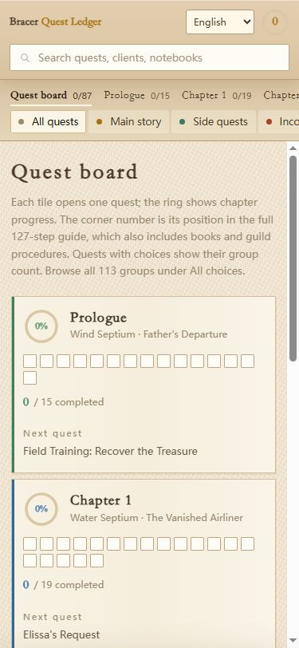

# Trails Board · 游击士委托台账 · 遊撃士依頼台帳

**中文 / English / 日本語 — 一个 APK 内切换三种语言。**

《空之轨迹 the 1st》的离线任务、选项和成就攻略工具。
An offline quest, choice and achievement companion for *Trails in the Sky 1st Chapter*.
『空の軌跡 the 1st』の依頼・選択肢・実績を確認できるオフライン攻略ツールです。

> **🆕 v16.0（2026-10-18）— 怪物图鉴完整版**：190 只魔兽属性 + 掉落（含掉落率）+ 出没地；另有选项台账全覆盖、战技·魔法全表 123 条、资料库 8 分区。
> [下载 trails_board_v16.apk](https://github.com/YUCAII/trails-board/releases/download/v16.0/trails_board_v16.apk) · [v16.0 Release 说明](https://github.com/YUCAII/trails-board/releases/tag/v16.0)
> 与下方 v10 多语言版相互独立，可共存安装（包名与签名均不同）。

[下载 v10 APK / Download v10 APK](https://github.com/YUCAII/trails-board/releases/download/v10.0/trails_board_v10_multilang.apk) · [v10.0 Release](https://github.com/YUCAII/trails-board/releases/tag/v10.0) · [构建说明 / Build / ビルド](docs/BUILD.md)

| 中文 | English | 日本語 |
| --- | --- | --- |
|  |  |  |

## 中文

### 功能

- 顶部语言菜单可随时切换中文、英文和日文，并记住选择。
- 87 个任务、113 组选项、178 项游戏内成就、43 项 Steam 成就。
- 任务标题、委托人、攻略步骤、手册正文、推荐选项及成就条件均提供英、日译文，共覆盖 1,560 条不同正文。
- 支持跨语言搜索、章节与主支线筛选、只看未完成，以及任务和成就完成标记。
- 内容和进度存储在本地，无需登录；Steam 达成率是随安装包附带的数据快照。

### 安装

下载 Release 中的 `trails_board_v10_multilang.apk`，在 Android 6.0 或以上设备打开并安装。需要时允许当前文件管理器或浏览器安装应用。

v10.0 包名为 `com.trails.board.multilang`。由于原 v9 签名私钥未提供，此版使用新签名和独立包名，可与原版共存。原版进度不会自动迁移；本版内切换语言不会清空进度。

### 验证与来源

已通过全部正文译文覆盖检查、三语 DOM 集成检查、任务四个详情标签页、搜索与进度持久化检查，以及 375px 手机宽度布局检查。APK 通过 Android 官方 `apksigner` 的 v1/v2 签名验证和 `aapt` 包信息检查；尚未完成 Android 真机安装测试。

本项目从用户提供的 v9 APK 提取离线页面和 Android WebView 壳，加入三语功能。仓库包含页面源代码、翻译数据、构建工具和原有 Android 壳的编译产物；不包含原 Android Java/Kotlin 工程。译文为非官方译文，游戏名称、正文和相关素材的权利归各自权利人所有，公开此仓库不代表重新授权这些内容。

## English

### Features

- Switch between Chinese, English and Japanese using the language menu at the top. Your selection is remembered.
- Browse 87 quests, 113 choice groups, 178 in-game achievements and 43 Steam achievements.
- English and Japanese translations cover quest names, clients, walkthrough steps, notebook text, recommended choices and achievement requirements: 1,560 distinct content strings.
- Search in any of the three languages, filter by chapter or quest type, show incomplete entries and track completion locally.
- All content works offline without an account. Steam completion percentages are a bundled snapshot.

### Installation

Download `trails_board_v10_multilang.apk` from the Release and open it on Android 6.0 or newer. Allow installation from your file manager or browser if prompted.

Version 10.0 uses package `com.trails.board.multilang` and a new signing certificate because the original v9 signing key was not provided. It can coexist with v9. Existing v9 progress does not migrate automatically; switching languages within v10 preserves its progress.

### Validation and provenance

Checks cover every translation, all three languages, each quest's four detail tabs, search, persistent progress and a 375px phone layout. The APK passes official Android v1/v2 signature verification and package inspection. Installation on a physical Android device has not yet been tested.

The original offline page and compiled Android WebView shell were extracted from the user-provided v9 APK. This repository includes editable web code, translation data, build tools and the compiled shell; the original Android Java/Kotlin project is unavailable. Translations are unofficial. Game text, names and related assets remain the property of their respective rights holders; publication does not grant a new license to that material.

## 日本語

### 機能

- 画面上部の言語メニューから中国語・英語・日本語を切り替えられます。選択した言語は保存されます。
- 依頼87件、選択肢113組、ゲーム内実績178項目、Steam実績43項目を収録しています。
- 依頼名・依頼人・攻略手順・手帳本文・推奨選択肢・実績条件など、異なる本文1,560件に英語と日本語の訳文を用意しました。
- 三言語での検索、章・依頼種別による絞り込み、未達成のみの表示、達成状況の記録に対応しています。
- アカウント登録は不要で、内容と進捗は端末内に保存されます。Steam達成率は同梱されたデータのスナップショットです。

### インストール

Releaseから `trails_board_v10_multilang.apk` をダウンロードし、Android 6.0以降の端末で開いてインストールしてください。必要に応じて、使用中のブラウザーまたはファイル管理アプリからのインストールを許可してください。

v10.0のパッケージ名は `com.trails.board.multilang` です。元のv9の署名鍵が提供されていないため、新しい署名と別のパッケージ名を使用しています。v9と共存できますが、v9の進捗は自動移行されません。v10内で言語を変更しても進捗は保持されます。

### 検証と出典

全訳文の収録、三言語の画面、各依頼の4タブ、検索、進捗保存、幅375pxの表示を検証しました。Android公式ツールによるv1/v2署名検証とパッケージ情報の確認に合格しています。Android実機へのインストール検証は未実施です。

提供されたv9 APKからオフラインページとコンパイル済みのAndroid WebViewシェルを取り出し、三言語機能を追加しました。編集可能なWebコード、翻訳データ、ビルドツール、コンパイル済みシェルを公開しています。元のAndroid Java/Kotlinプロジェクトは含まれていません。翻訳は非公式です。ゲーム本文・名称・関連素材の権利は各権利者に帰属し、本公開によって新たな利用許諾を付与するものではありません。
